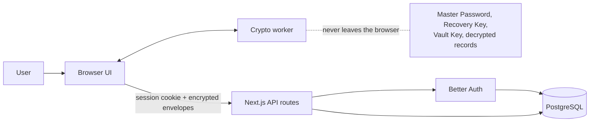

# Architecture

Keymint is a Next.js application with three main parts: a browser crypto boundary, an authentication and API server, and a PostgreSQL database.



## Two secrets, two boundaries

Keymint deliberately separates account access from vault access.

| Secret | Checked by | Protects | Can be reset by email? |
|---|---|---|---|
| Login password | The server (Better Auth, Argon2id hash) | Your account and sessions | Yes |
| Master Password | The browser crypto worker | The Vault Key, and so all vault contents | No. Use the Recovery Key. |

Resetting the login password never decrypts or resets the vault. Changing the Master Password never touches the account password.

## Components

| Component | Location | Responsibility |
|---|---|---|
| Pages | `app/(auth)`, `app/(vault)` | Sign-in, vault, and settings user interfaces |
| Proxy | `proxy.ts` | Per-request CSP nonce, `no-store` caching for pages, redirects to sign-in |
| Better Auth | `lib/auth.ts`, `app/api/auth` | Accounts, verification, password reset, sessions, TOTP, passkeys |
| API routes | `app/api/**` | Origin checks, validation, authorisation, encrypted sync, profile, activity |
| Crypto worker | `features/vault/crypto.worker.ts` | Key derivation, wrapping, record encryption, backups, recovery |
| Vault protocol | `lib/vault-crypto/` | Types, encoding, validation, and the cryptographic operations the worker uses |
| Storage services | `server/` | Owner-scoped, transactional reads and writes of encrypted data |
| Database | `prisma/` | Schema, migrations, and SQL constraints |

## Key hierarchy

```text
Master Password ──Argon2id──▶ Master KEK ───AES-256-GCM──▶ Vault Key
Recovery Key ─────HKDF-SHA-256──▶ Recovery KEK ─AES-256-GCM──▶ Vault Key
Vault Key ─────────────────────────────AES-256-GCM──▶ every vault record
Backup passphrase ─Argon2id──▶ Backup KEK ─AES-256-GCM──▶ .kmvault archive
```

The Vault Key is generated randomly in the worker and is never stored unencrypted. The server stores two **wrappers**: the Vault Key encrypted under the Master KEK, and the Vault Key encrypted under the Recovery KEK. [Security model](security-model.md#cryptography) lists the exact parameters.

## Vault lifecycle

### Setup

1. The worker generates a Vault Key and a Recovery Key.
2. It creates the master and recovery wrappers and tests that both open correctly.
3. The user saves the Recovery Key and types it back in to confirm.
4. `POST /api/v2/vault/setup` stores both wrappers. The server validates their structure but cannot open them.

### Unlock

1. The browser downloads the master wrapper from `GET /api/v2/vault/bootstrap`.
2. The worker derives the Master KEK from the Master Password and opens the wrapper.
3. The browser downloads the encrypted records, and the worker decrypts them.

A wrong Master Password simply fails to decrypt the wrapper locally. There is no server endpoint that checks Master Passwords.

The vault locks automatically after 15 minutes of inactivity, after 5 minutes hidden, on navigation away, on sign-out, or when another tab changes a wrapper. Locking terminates the worker and clears decrypted data from memory, as far as JavaScript allows.

### Records and changes

Each vault item is a **record** of type `credential`, `category`, `vaultSettings`, or `vaultActivity`. A deleted record becomes an encrypted `tombstone`.

Every record is encrypted as a whole. Its protected header binds the owner, vault, record ID, type, revision, state, and protocol versions as authenticated data. If any of these is tampered with, decryption fails.

To change a record:

1. The browser builds the new record with the next revision.
2. The worker encrypts it with a fresh nonce.
3. The server validates the envelope's structure and routing metadata.
4. In a single transaction, the server checks the expected revision, advances the vault's sync sequence, stores the envelope, and records a mutation receipt for idempotent retries.

If two devices edit the same record, the second write fails with `409 Conflict` and must be retried against the latest revision.

### Synchronisation

Every vault has a `syncSequence` counter. Each mutation transaction advances it once. Clients ask for records changed after their cursor, in pages of up to 500 records. A page never splits records written by the same mutation. Each vault can hold up to 2,500 records, tombstones included, which bounds per-account storage.

### Master Password change and recovery

- **Changing the Master Password** creates a new master wrapper for the same Vault Key. Records are not re-encrypted. The server requires a recent sign-in (under 5 minutes).
- **Recovery** uses the Recovery Key to open the Vault Key locally. It then sets a new Master Password and issues a new Recovery Key, and both wrappers are replaced atomically.

### Vault Key rotation

If the Vault Key may have been exposed, rotation replaces it completely:

1. The worker generates a new Vault Key and Recovery Key.
2. It re-encrypts every record, uploading them in resumable batches into a staging area.
3. `POST /api/v2/vault/rotation/commit` swaps the records and wrappers and advances the key version in one transaction, but only if the vault has not changed since rotation began.

If anything changes during rotation, the commit is rejected and the old key stays active.

### Backups

A `.kmvault` file contains the vault's records together with the source Vault Key, all encrypted as one authenticated archive. The archive is protected either by a separate backup passphrase or by the Recovery Key. On import, the worker decrypts the backup and re-encrypts its items under the current Vault Key.

## Data model

| Model | Purpose |
|---|---|
| `User`, `Account`, `Session`, `Verification` | Better Auth accounts, password hashes, sessions, and verification tokens |
| `TwoFactor`, `Passkey` | TOTP secrets and recovery codes (encrypted), and WebAuthn credentials |
| `Vault` | One per user. Holds the protocol version, key version, and sync sequence. |
| `VaultKeyEnvelope` | The master and recovery wrappers |
| `VaultRecord` | The current encrypted revision of each record, or its tombstone |
| `VaultMutation` | Idempotency receipts, kept for 7 days |
| `VaultKeyRotation`, `VaultKeyRotationRecord` | Staging area for an in-progress key rotation |
| `ActivityLog` | Coarse account activity, kept for 90 days |
| `EmailChangeRequest` | One in-progress, two-step email change per account |
| `RateLimit`, `RateLimitBucket` | Abuse protection counters |

Composite foreign keys tie every vault-owned row to the same user. SQL `CHECK` constraints in the migrations enforce metadata consistency, encoding, and size limits that Prisma's schema cannot express.

## Authentication

- Registration is off by default, and it requires email delivery.
- An email address must be verified before password sign-in works.
- Login passwords must be 12 to 128 characters and are hashed with Argon2id.
- Sessions last 7 days and refresh daily. Cookies are `HttpOnly` and `SameSite=Lax`, and also `Secure` in production.
- Password reset revokes all sessions and trusted devices.
- TOTP accepts a one-step clock window, and each accepted code is claimed atomically so it cannot be replayed.
- Passkeys require user verification.
- An email change needs the login password plus a confirmation from both the current and the new address. Completing it signs out every session.
- Sensitive actions, such as changing a wrapper or rotating the key, need a sign-in from the last 5 minutes.

## HTTP security

- Each page gets a per-request CSP nonce with `strict-dynamic`, and inline scripts are not allowed.
- Sensitive responses are sent with `Cache-Control: no-store`.
- Every state-changing request must come from the app's exact origin.
- Request bodies are size-limited while streaming and validated with strict Zod schemas.
- Other headers set: frame denial, `nosniff`, a restrictive `Permissions-Policy`, COOP/CORP, and HSTS in production.
